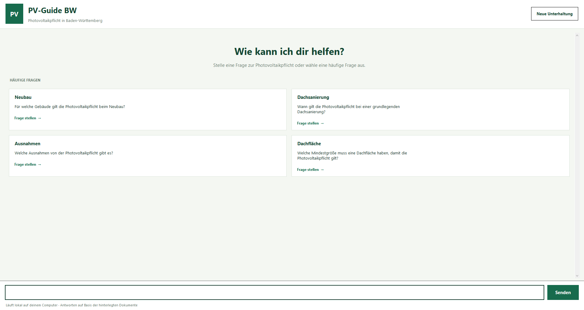
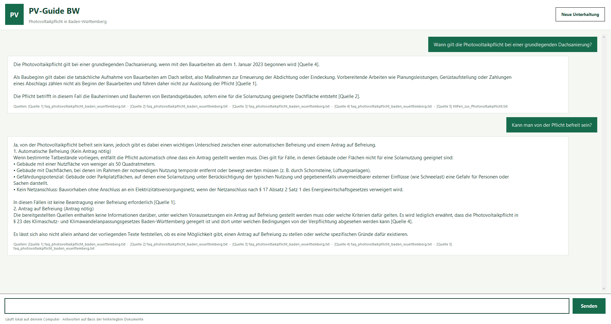

# PV-Guide BW

**A local Retrieval-Augmented Generation (RAG) assistant for photovoltaic installation requirements in Baden-Württemberg, Germany.**

<p align="center">
  
  
</p>

## Overview

PV-Guide BW is a local question-answering assistant designed to provide accessible information about photovoltaic installation requirements in Baden-Württemberg. It combines semantic document retrieval with a local language model to generate answers grounded in the provided legal and informational documents.

The project explores how retrieval-augmented generation can support domain-specific information retrieval while retaining references to the underlying sources.

## Method

The system follows a three-stage pipeline:

1. **Document preparation:** Source documents are cleaned and divided into overlapping text chunks.
2. **Hybrid retrieval:** Text embeddings generated with `nomic-embed-text` are compared using cosine similarity. A lexical keyword score supplements semantic retrieval. The combined score assigns weights of 0.75 to semantic similarity and 0.25 to keyword overlap.
3. **Answer generation:** The highest-ranked text passages are provided to `qwen3.5:4b` via Ollama. The model is instructed to answer in German, use only the retrieved sources, and cite relevant passages.

A Tkinter-based desktop interface provides question input, suggested questions, conversation history, and source references. The models run locally through Ollama.

## Project Structure

```text
pv-guide-bw/
├── app/        # Document processing, retrieval, and application code
├── data/       # Raw source documents and processed data
└── img/        # Screenshots of the interface
```

## Requirements

- Python
- [Ollama](https://ollama.com/)
- `nomic-embed-text` for embeddings
- `qwen3.5:4b` for answer generation
- Python packages used by the application, including `ollama`

Download the required models using:

```bash
ollama pull nomic-embed-text
ollama pull qwen3.5:4b
```

## Usage

Run the following commands from the project root to prepare the documents, build the search index, and launch the desktop application:

```bash
python app/prepare_documents.py
python app/build_search_index.py
python app/desktop_app.py
```

The assistant's responses depend on the coverage and relevance of the indexed documents. Generated answers should therefore be checked against the cited sources, particularly when interpreting legal requirements.

## Other Contributions

- ChatGPT has benn used for coding, text and formatting assistance.
